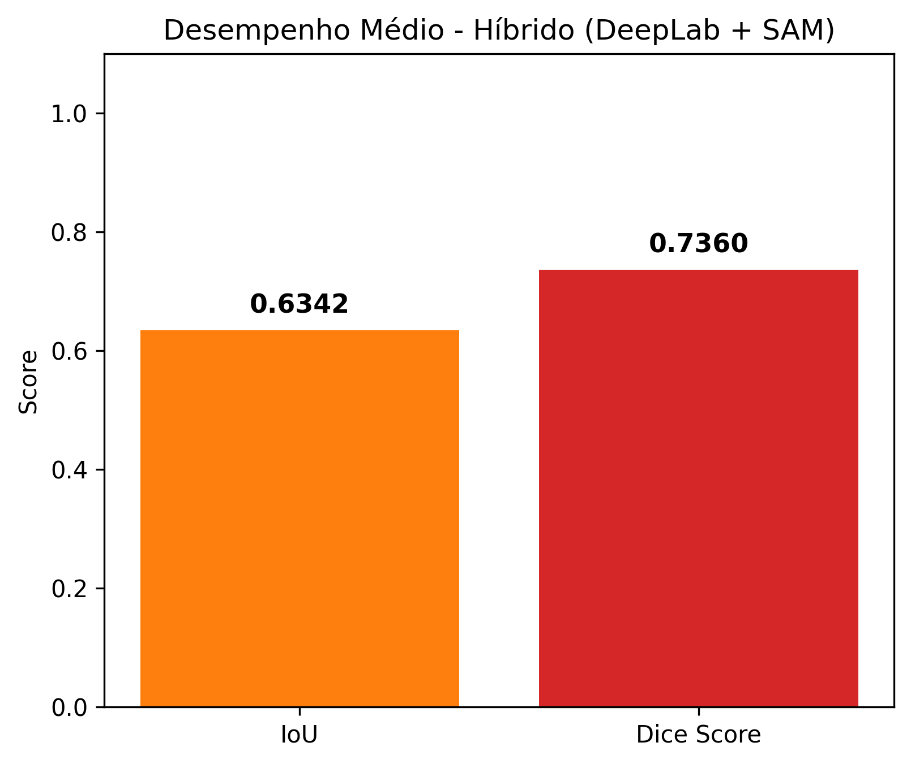
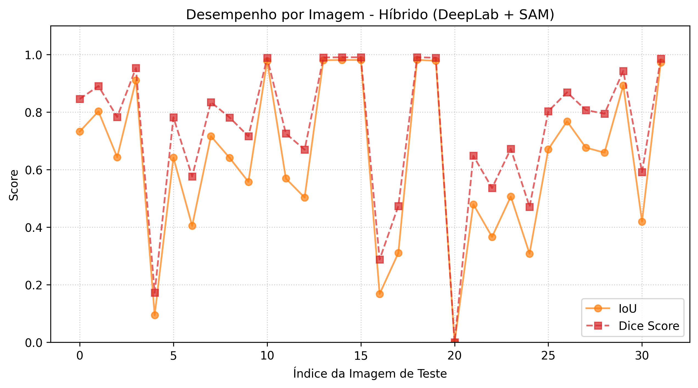
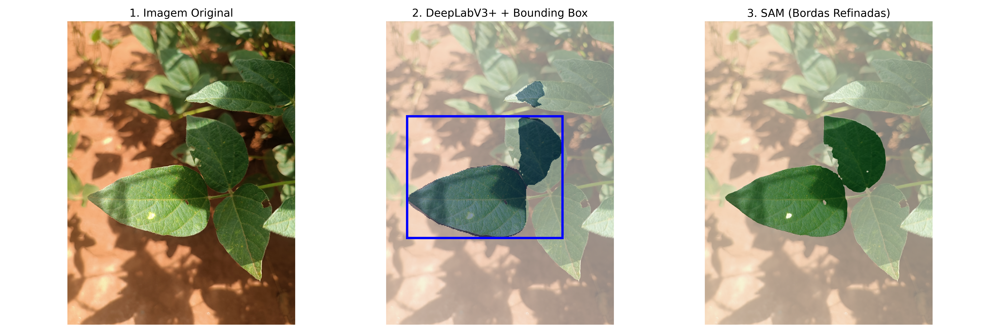
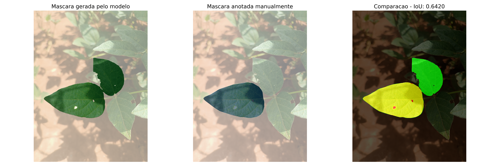

# projeto_soja_sam-DeepLab — Segmentação de folhas de soja com DeepLabV3+ + SAM

Variação do [projeto_soja_sam](https://github.com/pedroh-1/projeto_soja_sam) em que o detector inicial é o **DeepLabV3+ (MobileNetV2)** em vez da U-Net. O DeepLab localiza a folha, a bounding box da máscara vira prompt e o **SAM ViT-B com fine-tuning** refina as bordas.

## Resultados

Pipeline híbrido DeepLabV3+ + SAM no conjunto de teste (32 imagens anotadas no LabelMe):

| Métrica | Valor |
|---|---|
| IoU médio | **0,6342** |
| Dice médio | **0,7360** |

É o melhor resultado entre os pipelines híbridos com o SAM (U-Net + SAM: IoU 0,5386).






## Como funciona

1. **DeepLabV3+** ([`model_factory.py`](model_factory.py)): `smp.DeepLabV3Plus` com encoder `mobilenet_v2`, 1 classe de saída. Os pesos vêm do projeto [DeepLabV3_Soja](https://github.com/pedroh-1/DeepLabV3_Soja) (`weights_DeepLab/best_deeplab_soja.pth`). A resolução de entrada e o threshold são lidos do próprio checkpoint.
2. **Bounding box**: aplica sigmoide e threshold, volta a máscara ao tamanho original e pega a caixa do maior contorno.
3. **SAM** (`weights/sam_soja_epoca_1.pth`): segmenta a folha usando a caixa como prompt.
4. **Visualização**: salva as etapas do pipeline e o comparativo com a anotação manual (amarelo = interseção, verde = só modelo, vermelho = só anotação).

O fine-tuning do SAM ([`train.py`](train.py)) é o mesmo do projeto base: só o `mask_decoder` é treinado, com Dice Loss, Adam (`lr=1e-5`) e prompts de caixa extraídos das anotações.

**GPU AMD/ROCm:** a função `selecionar_device()` detecta GPUs `gfx1102` sem suporte no rocBLAS e usa a CPU automaticamente.

## Dados

Formato LabelMe (`.jpg` + `.json` com polígonos), com `data/train/`, `data/val/` e `data/test/`. Os dados e os pesos não estão no repositório.

## Estrutura

```
projeto_soja_sam-DeepLab/
├── auto_inference_deeplab.py   # Pipeline DeepLab → bbox → SAM em uma imagem
├── avaliar_pipeline_hibrido.py # Avaliação do pipeline no teste + gráficos
├── model_factory.py            # Criação do DeepLabV3+
├── train.py                    # Fine-tuning do mask decoder do SAM
├── test.py                     # Avaliação do SAM com caixas reais
├── inference.py                # Segmentação interativa por clique
├── utils/                      # Dataset LabelMe e métricas
├── resultados/                 # Exemplos visuais
├── weights/                    # SAM (não versionado)
└── weights_DeepLab/            # DeepLabV3+ (não versionado)
```

## Requisitos

```bash
pip install torch torchvision segmentation-models-pytorch opencv-python numpy matplotlib tqdm
pip install git+https://github.com/facebookresearch/segment-anything.git
```

## Uso

```bash
# Pipeline em uma imagem (ajuste imagem_teste no final do script)
python auto_inference_deeplab.py

# Avaliação no conjunto de teste
python avaliar_pipeline_hibrido.py
```
